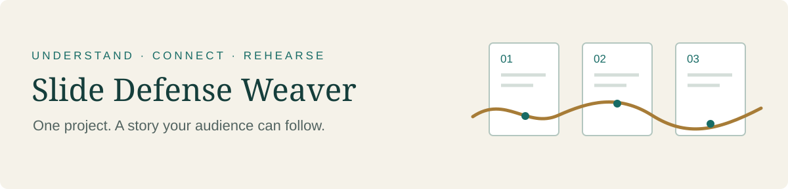
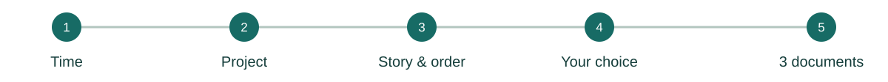

# Slide Defense Weaver

**让每一页共同讲完一个故事。**

[English](../README.md) · 简体中文



答辩需要让听众跟上你的思路：问题是什么、为什么这样解决、证据说明了什么，以及这项工作有什么价值。Slide Defense Weaver 会阅读项目材料和 PPT，理解其中的核心故事，**先与你讨论页序，再写稿**。

你决定先调整 PPT，还是保留当前顺序直接出稿。随后，它会生成三个独立 Word 文件，用于正式陈述和答辩练习。

[](https://github.com/hujizhou35-cmd/slide-defense-weaver/releases/latest)
[](../LICENSE)
[](https://github.com/hujizhou35-cmd/slide-defense-weaver/issues)

## 从这里开始

| 下载形式 | 适合的使用方式 |
| --- | --- |
| [完整 Skill `.skill`](https://github.com/hujizhou35-cmd/slide-defense-weaver/releases/download/v1.0.0/slide-defense-weaver-v1.0.0.skill) | 获得技能目录、参考文档和检查脚本 |
| [Plugin `.zip`](https://github.com/hujizhou35-cmd/slide-defense-weaver/releases/download/v1.0.0/slide-defense-weaver-plugin-v1.0.0.zip) | 在 Codex 或 Claude Code 中使用插件包 |
| [独立 `SKILL.md`](https://github.com/hujizhou35-cmd/slide-defense-weaver/releases/download/v1.0.0/SKILL.md) | 交给能读取指令文件的 AI；必要写作参考已经内联 |

Codex、Claude Code 和其他 AI 的使用方法见[简短安装说明](install.zh-CN.md)。独立文件使用等价的检查清单，不附带完整包里的 Python 辅助脚本。

准备好**项目计划书、报告或等价说明**，以及 **PPT**。说明正式陈述和提问时间，也可以让技能先向你询问。它还会确认视频如何计时、比赛规则，以及团队部分是略讲、详讲还是禁止展示。

```text
使用 Slide Defense Weaver 阅读我的项目报告和PPT。
正式陈述5分钟，提问2分钟，分别计时。
先告诉我你理解的完整故事，并提出具体的PPT顺序建议。
等我选择后，再生成三份答辩准备文档。
```

## 三类内容，分别练习

| 输出 | 你会得到什么 |
| --- | --- |
| **逐页答辩稿** | 与实际 PPT 逐页对应的讲稿、自然衔接、时间安排，以及与正文分开的翻页提示 |
| **模拟提问对照** | 评委可能怎样问、真正关心什么、简短回答、追问展开和材料依据 |
| **压力与找茬测试** | 面对贡献、能力或证据质疑时，练习平静、直接、不卑不亢的回答 |

第三份也算是作者的一点恶趣味。像**“这些真是你自己做的吗？”**这样不舒服的问题，提前练过真实的回答，上场时更容易稳住。练习的目的在于说清事实，不靠油滑话术或反击评委。

## 故事怎样形成



1. **确认时间。** 分清陈述和提问时长，确认视频、演示怎样计时。
2. **理解项目。** 阅读报告和每张幻灯片，包括关键图片与图表；发现缺失或矛盾时追问。
3. **讨论故事和页序。** 解释完整叙事及每页的作用，给出有具体理由的移动或合并建议。
4. **由你选择。** 先自行修改或委托 AI 修改 PPT，或者按当前实际页序直接出稿。
5. **准备与练习。** 交付逐页稿、模拟提问和压力问答三个 Word 文件。

纯章节过渡页**不安排朗读正文**，衔接放在前后内容页。团队介绍按你选择的详细程度和比赛规则处理。

## 看一个小例子

*虚构项目：实验室器材交接记录工具。*

**各讲各的**

> “接下来介绍系统功能。系统可以记录器材交接。”
>
> “接下来介绍用户试用。我们开展了用户试用。”

**连贯地讲**

> “我们把记录放进交接步骤，让器材交到下一位使用者手里时，相应记录也能留下来。”
>
> “随后，我们检查使用者能否完成这套流程。10名测试者都完成了指定操作，但我们还没有测量节省的时间，也没有观察长期使用效果。”

衔接来自工作与证据之间真实的关系。单纯增加“然后”“接下来”并不能形成故事。

**页序建议：** 把流程说明放到试用结果之前，让评委先知道测了什么。若保留当前顺序，讲稿先交代已经做成原型及有限的试用结果，再解释原型的具体做法。

还有一个压力问题及回答示例，见[完整短例](example.zh-CN.md)。

## 使用前了解这些

- 优先适配项目竞赛，也适用于毕业和科研答辩。
- 讲稿默认中文，可要求英文或其他语言；主页默认英文，可切换完整中文版。
- AI 所在环境需要能够读取材料、检查幻灯片、生成 Word 并渲染检查排版。插件不会自动安装 Office、OCR 或文档渲染器。
- Python 辅助脚本检查页面对应和已提供的时间预算；实际用时仍需排练确认。
- 事实来自材料和你确认的说明，不编造结果或个人贡献。

## 反馈与源文件

安装失败、讲稿衔接不顺，或者有更好的练习点子，都欢迎[提交 Issue](https://github.com/hujizhou35-cmd/slide-defense-weaver/issues)。中英文均可，分享材料时请使用虚构或脱敏示例。

当前技能源文件位于 `skills/`，构建工具和测试位于 `development/`。普通使用者从 Release 下载即可。

作者：**Jizhou Hu** · [MIT License](../LICENSE)
